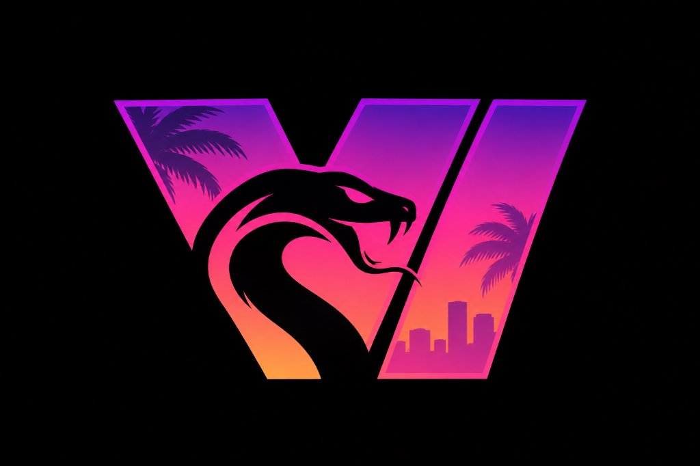

<p align="center">
  
</p>

<h1 align="center">Anaconda</h1>

<p align="center">
  <strong>Low-VRAM (4 GB) &amp; No-RT fork of VIctory / cool_fox with built-in Series S FSR + RCAS upscaling.</strong>
</p>

> **This repository contains no game files, code, or assets.** You must supply your own Xbox Series dump at runtime. Not affiliated with or endorsed by any game developer or publisher.

---

## Key Features (4 GB VRAM / No-RT Edition)

Built on top of `codec-d/cool_fox` (`pareto-residency`) and `VIctory`, tuned specifically for **4 GB VRAM GPUs without hardware Ray Tracing** (tested on **GTX 1650 4 GB + Ryzen 5 5500 + 16 GB RAM**):

1. **<= 4 GB VRAM Cap (`VICTORY_VRAM_MB`)**
   - Hard-caps the host DXGI local VRAM budget (`VICTORY_VRAM_MB=3050`) across texture residency, staging pools, and buffer mirroring (`crates/victory-gpu/src/host.rs`).
   - Triple-buffered swap chain (`BUFFERS=3`) with configurable VSync (`VICTORY_VSYNC=1`) to prevent screen tearing/flickering.
2. **Built-in Series S FSR + RCAS GPU Compute Upscaler**
   - Implements `amd_fidelityfx_loader_xbox.dll` directly in Rust (`crates/victory-hle/src/modules/fidelityfx.rs`) backed by a zero-dependency D3D12 `cs_5_1` compute shader with 5-tap clamped RCAS sharpening (`crates/victory-gpu/src/external.rs`).
   - Full `VICTORY_THIN=1` multi-threaded command list translation support (`BUILTIN_UPSCALE` op in `crates/victory-gpu/src/list/thin.rs`).
   - Configurable render scale (`VICTORY_FSR_SCALE=2.0` -> `960x540` internal -> `1920x1080` output) and sharpness (`VICTORY_FSR_SHARPEN=0.45`).
3. **Works Without Hardware Ray Tracing**
   - Software interior ambient lighting compensation (`VICTORY_AMBIENT=0.8`, `VICTORY_AMBIENT_AIR=1.5`) paired with `rtDynamicShadows=false` / `rtLODLightShadows=false` in the Very Low preset.
4. **Optimized Shader & Texture Streaming**
   - NVIDIA Wave32 lowering + DXIL optimization passes (`VICTORY_SHADER_OPT=63`) + safe NVIDIA pipeline library locking (`VICTORY_LIBRARY_LOCK=1`, `VICTORY_LIBRARY_MAP=0`).
   - On-demand tiled texture residency (`VICTORY_LEVELS_ON_DEMAND=1`), async copy-queue uploads (`VICTORY_UPLOAD_AHEAD=1`, `VICTORY_TEXTURE_NO_WAIT=1`), plus optional placed-texture mip-drop (`VICTORY_TEXTURE_DROP`) with safe `CopyTextureRegion` subresource remapping.
5. **Very Low Graphics Preset**
   - Ready-to-use Series S Very Low / No-RT / FSR Performance config template in [`docs/settings-very-low.xml`](docs/settings-very-low.xml) (`manualMipBias=2.0`, `grassLod=0.2`, `lodScale=0.5`, `waterReflectionSSR=false`, `motionBlur=false`).

---

## Quick Start

### Requirements
- Windows 10/11 x64
- CPU with AVX2
- Direct3D 12 GPU with Shader Model 6.6 & Mesh Shader support (4 GB+ VRAM, no hardware RT required)
- Pinned Rust toolchain (`rust-toolchain.toml`) + MSVC C++ Build Tools + Windows SDK
- Your own Xbox Series game dump

### Build & Run

```powershell
cargo build --release --locked -p victory
```

Point `VICTORY_GAME_DIR` at your dump folder and launch with the 4 GB preset:

```powershell
$env:VICTORY_GAME_DIR = 'D:\Path\To\YourDump'
.\Play-Anaconda.cmd
```

Optionally copy [`docs/settings-very-low.xml`](docs/settings-very-low.xml) into:
`%LOCALAPPDATA%\Anaconda\data-s\7952987A\storage\settings\settings.xml`

---

## Key Environment Switches

| Variable | Default in `Play-Anaconda.cmd` | Purpose |
|---|---|---|
| `VICTORY_VRAM_MB` | `3050` | Caps DXGI local VRAM budget (MiB) for 4 GB cards |
| `VICTORY_FSR_SCALE` | `2.0` | Internal FSR render scale (`1.5`=Quality, `1.7`=Balanced, `2.0`=Performance) |
| `VICTORY_FSR_SHARPEN` | `0.45` | RCAS contrast-adaptive sharpening strength (`0.0`–`1.0`) |
| `VICTORY_VSYNC` | `1` | Swap-chain sync interval (`0`=off, `1`=VSync, `2`=half-rate) |
| `VICTORY_LEVELS_ON_DEMAND` | `1` | Tiled on-demand mip residency |
| `VICTORY_TEXTURE_DROP` | `0` | Optional mip-drop floor (`1`–`3`) when using `VICTORY_LEVELS_ON_DEMAND=0` + `VICTORY_HELD_LEVELS=1` |
| `VICTORY_SHADER_OPT` | `63` | Proven DXIL shader optimization passes |
| `VICTORY_AMBIENT` / `VICTORY_AMBIENT_AIR` | `0.8` / `1.5` | Software ambient lighting without hardware RT |

---

## Credits

Anaconda builds directly on the shoulders of the VIctory community:

- **[codec-d/cool_fox](https://git.gtahub.st/github/codec-d--cool_fox)** (`pareto-residency`): NVIDIA Wave32 lowering, Series S two-plane UI compositor, thin command lists, and residency work.
- **[VIctory](https://github.com/Marvisak/VIctory)** by Marvisak and contributors: core loader, HLE services, D3D12 backend, and shader recompiler.
- **[fxceless/victory-fork](https://github.com/fxceless/victory-fork)**, **[DexNom/VIctory](https://github.com/DexNom/VIctory)**, **[Belobug/VIctory-Belobug-AMD](https://github.com/Belobug/VIctory-Belobug-AMD)**, **[myokex/victory-amd](https://github.com/myokex/victory-amd)**, **[FQY55kai/ZJOU-VICTORY](https://github.com/FQY55kai/ZJOU-VICTORY)**, **Geckomacabre**, and **cxy0072019-sketch**.

## License

GPL-3.0-or-later, matching VIctory. See [`LICENSE`](LICENSE) and [`docs/asset-policy.md`](docs/asset-policy.md).
